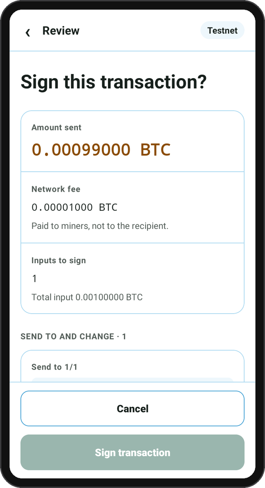
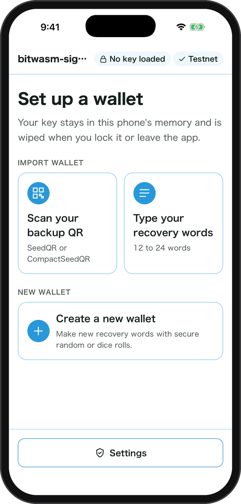

# bitwasm-signer-app

<sup>[English](../../README.md)</sup>

`bitwasm-signer` の parser / signer WASM を使うAndroid / iOSの署名アプリです。初めの設定ではアプリは鍵を持たず、署名のたびに読み込み、使い終わったら消します。

**[ブラウザでテストネットのデモを試す](https://habakan.github.io/bitwasm-signer-app/)** · **[USBで入れる](https://habakan.github.io/bitwasm-signer-app/install/)** · **[ドキュメント](https://habakan.github.io/bitwasm-signer-app/docs/ja/)**

> **注意:** 実験的なソフトウェアです。監査を受けておらず、無保証です。使用によって生じた資金の損失やその他の損害について、作者は責任を負いません。使う場合は少額にとどめてください。

## 画面

Android（Android 10）とiOSシミュレーターの画面です。テストネットで、公開されているBIP39のテスト用ニーモニックを使っています。

<p align="center">
&nbsp;&nbsp;

</p>

## Android / iOSでできること

「確認済み」はAndroid 10の端末（ARMv7）で試したもの、「実装済み」はコードはあるものの端末ではまだ試していないものです。iOSはシミュレーターでしか動かしていません。

| 機能 | 内容 | Android | iOS |
| --- | --- | --- | --- |
| SeedQRの読み込み | SeedQR / CompactSeedQRを任意のBIP39パスフレーズ付きで、または64バイトのseedを読み込み、端末内で鍵を導出 | 確認済み | 実装済み |
| 単語の入力 | BIP39英単語（12〜24語）をアプリ内のキーボードで1語ずつ入力し、任意のパスフレーズ付きで読み込み。続く語がない文字は押せず、最後の語はチェックサムに合う候補だけになる | 実装済み | 実装済み |
| ニーモニックの作成 | SecureRandom、またはちょうど50 / 99回のサイコロの目（SeedSignerやKruxと同じハッシュの取り方）から12 / 24語を作成。目に偏りや規則性があれば警告し、単語がどう計算されたかを表示し、Standard / Compact SeedQRを表示 | 実装済み | 実装済み |
| 書き写しの確認 | 作成したニーモニックは4択5問の確認に通ったあと、そのまま署名鍵として読み込める | 実装済み | 実装済み |
| BIP85 | 子ニーモニックを導出 | 実装済み | 実装済み |
| PSBTのレビュー | カメラでアニメーションUR `crypto-psbt` を受信し、parser.wasmで解析し、signer.wasmのレビュー内容をネイティブ画面で確認 | 確認済み | 実装済み |
| 署名 | 明示承認後に署名し、署名済みPSBTをアニメーションURで表示。ウォレットとの往復は未確認 | 実装済み | 実装済み |
| アカウントの書き出し | 公開鍵をアニメーションUR `crypto-account`（BIP49 / BIP84 / BIP86 / BIP48）で表示し、Sparrow / Nunchuk / Keystone形式のウォレットが読める。アカウントxpubとdescriptorもQR表示 | 実装済み | 実装済み |
| マルチシグ | P2WSHマルチシグ（3鍵まで）をdescriptor / BSMS / Coldcard形式のQR（`ur:bytes`も可）から、鍵の一覧と最初の受取アドレスを確認してから登録。登録後はお釣りをお釣りと表示し、別ウォレットの入力は署名しない。`crypto-output`で書き出せ、保存モードではseedと一緒に復元される | 実装済み | 実装済み |
| アドレスとメッセージ | アドレスの所有確認とBIP137メッセージ署名 | 実装済み | 実装済み |
| 鍵の消去 | Lock、またはアプリがバックグラウンドへ移ったときに署名鍵を消去 | 実装済み | 実装済み |
| 端末への保存 | 設定で「Save on device」を選ぶと、12 / 24語のseedを端末に保存（既定はRAMのみ）。詳しくは下記 | 実装済み | 実装済み |

ニーモニック、SeedQR、生seed、パスフレーズはWebViewへ返しません。

## 端末への保存

保存するのはBIP39のエントロピー（CompactSeedQRと同じ16 / 32バイト）だけです。パスフレーズは保存せず、適用後のマスターフィンガープリントを保存します。アンロック時にパスフレーズを入力し、フィンガープリントが一致しなければ読み込みません。64バイトの生seedと、15 / 18 / 21語のseedは保存できません。

| | Android | iOS |
| --- | --- | --- |
| 暗号化 | seedごとのKeystore AES-256-GCM鍵（StrongBoxがあれば使用。TEEかStrongBoxにない鍵では保存しない。画面ロック中は使えない） | seedごとのSecure Enclave P-256鍵でECIES（X9.63 SHA-256, AES-GCM） |
| 認証 | 使うたびに生体認証または画面ロック（Android 10以前は認証後15秒間） | Face ID / Touch ID またはパスコード（`.userPresence`） |
| 保存先 | `noBackupFilesDir/vault.json`（`allowBackup="false"`） | Keychain（`WhenPasscodeSetThisDeviceOnly`） |

画面ロック（パスコード）がない端末では保存モードを選べません。削除と全消去にも端末の認証が要ります。保存済みのseedがある間は保存モードをオフにできません。iOSではアプリスイッチャーの画面と画面収録中の表示を黒で覆います。スクリーンショット自体はiOSでは止められません。入力、レビュー、秘密情報の表示、鍵導出、署名はネイティブ層で行います。公開アカウント情報、署名済みPSBT、メッセージ署名はネイティブ画面で表示します。

キーボードの学習やオートフィルの扱いは[faq.md](faq.md)にまとめています。

## 署名専用機にする

Android では、Signer Lockdown（`lockdown/`）で工場出荷リセットした端末を署名専用機にできます。ようこそ画面でリリースの QR を読むか、端末をネットワークにつながずに[導入ページ](https://habakan.github.io/bitwasm-signer-app/install/)から USB で入れます。同じページで、Lockdown なしで署名アプリだけを入れることもできます。署名アプリを入れ、機内モードを固定し、USB デバッグ・アプリやアカウントの追加を禁止し、署名に要らないアプリを隠します。署名アプリの更新は SD カードか、PC との USB 接続でできます。詳しくは[lockdown.md](lockdown.md)にまとめています。

## WASM

WASMは`src-tauri/plugins/signer/android/src/main/assets/`に同梱し、ロード時にSHA-256を照合します。

| Module | SHA-256 |
| --- | --- |
| parser.wasm | `9407abe3a65a56ebcfcab6da3b685f4e21ce9f6a60b3feddd299ddc0def89bab` |
| signer.wasm | `d27fe4f8050193cc7101cf7fab26b0740a1b39e33c867ebc66cd05d9f9003508` |
| checker.wasm | `7df36b4c3bfb2bec1826fb2a740e9f1ddd8281cb5530a878dc790ebfd7e63e37` |

checker.wasmはsigner.wasmとは別に書いたレビューのモデルです。signer.wasmのレビューが通ったあと、同じplanと前のトランザクション、signer.wasmの`signer_facts()`から同じ判断をさせ、合計・手数料・署名する入力・出力の持ち主、画面に出す各出力の金額とアドレス（またはOP_RETURNやスクリプトの16進）が一致したときだけ確認画面を出します。一致しなければ署名しません。

AndroidではRustのWasmiをJNI経由で実行します。iOSではSwiftプラグインからRustのWasmiホストを呼び出します。最小Android APIは26です。

## ビルド

Android Studio、Android SDK / NDK、JDK 25、Rustの`aarch64-linux-android`と`armv7-linux-androideabi`ターゲットを用意します。

```sh
pnpm install
pnpm build
JAVA_HOME=/path/to/jdk ANDROID_HOME=/path/to/android-sdk NDK_HOME=/path/to/ndk pnpm tauri android build --debug --target aarch64 armv7 --apk --ci
```

出力先は`src-tauri/gen/android/app/build/outputs/apk/universal/debug/app-universal-debug.apk`です。

### 実機ではreleaseビルドを使う

debugビルドはWASMを動かすRust側（Wasmi）が最適化なしでコンパイルされるため、実機では極端に遅くなります。ARMv7の端末ではニーモニックの読み込み（PBKDF2）に約90秒かかり、releaseビルドでは約3秒でした。動作確認はreleaseビルドで行います。

`src-tauri/gen/android/keystore.properties`（`storeFile` / `storePassword` / `keyAlias` / `keyPassword`、コミットしない）があればreleaseビルドはその鍵で署名されます。ない場合は未署名のAPKを作ってから署名します。下の例はdebug用の鍵での署名で、debugビルドと同じ鍵なので端末のデータを残したまま上書きできます。配布には使わないでください。

```sh
JAVA_HOME=/path/to/jdk ANDROID_HOME=/path/to/android-sdk NDK_HOME=/path/to/ndk pnpm tauri android build --target armv7 --apk --ci
BT=$ANDROID_HOME/build-tools/<version>
$BT/zipalign -f -p 4 src-tauri/gen/android/app/build/outputs/apk/universal/release/app-universal-release-unsigned.apk aligned.apk
$BT/apksigner sign --ks ~/.android/debug.keystore --ks-pass pass:android --key-pass pass:android \
  --ks-key-alias androiddebugkey --out bitwasm-signer-release.apk aligned.apk
adb install -r bitwasm-signer-release.apk
```

`--target`は端末のABIに合わせます（`adb shell getprop ro.product.cpu.abilist`。`arm64-v8a`なら`aarch64`）。

### APKの配布

`v<tauri.conf.jsonのversion>`のタグをpushすると、GitHub Actionsがrelease鍵で署名したuniversal APK（aarch64 / armv7）、そのAPKを同梱したSigner Lockdown、導入用のQR、`SHA256SUMS`をdraft releaseに添付します。リポジトリのSecretsに次を登録しておきます。

| Secret | 内容 |
| --- | --- |
| `ANDROID_KEYSTORE_BASE64` | release鍵のkeystoreをbase64にしたもの |
| `ANDROID_KEYSTORE_PASSWORD` | keystoreのパスワード |
| `ANDROID_KEY_ALIAS` | 鍵のalias |
| `ANDROID_KEY_PASSWORD` | 鍵のパスワード |

release鍵を変えると上書きインストールできず、アンインストールで端末に保存したseedも消えます。keystoreはリポジトリの外にバックアップします。

## ブラウザ版のデモ

https://habakan.github.io/bitwasm-signer-app/ で試せます（`main`からGitHub Actionsで公開）。

iOSと同じエンジン(`wasmi_host.rs`)をwasm32向けにビルドし、ページの中で動かします。テストネットだけで、鍵はBIP39のテスト用の単語(`abandon`を11回と`about`)に限ります。単語やSeedQRの入力はできません。新しいウォレットを作る流れ(ウォークスルー、サイコロ、書き写し、確認のクイズ)も試せます。作った単語はネットにつながったブラウザで作った本物のBIP39の単語なので、単語を表示する画面にはデモである旨を大きく表示します。ネットにつながった端末で動くので、本物の鍵やお金には使わないでください。

```sh
pnpm dev:web     # http://localhost:1420 で開く
pnpm build:web   # dist-web に出力
```

取引の署名は、カメラでウォレットアプリのQRを読み取るか、`samples/psbt-ur-test-only.png` と同じテスト用の取引で試せます。カメラはlocalhostかHTTPSのページでだけ使えます。

## ドキュメント

`docs/`(英語)と `docs/ja/`(日本語)のMarkdownを、VitePressで https://habakan.github.io/bitwasm-signer-app/docs/ に公開しています。フロントマターに `demo:` があるページは、右の欄にブラウザ版のデモを出します。`demo:` には節のIDと押すボタンを書き、その節までスクロールするとスマホがその画面に進みます(`docs/ja/index.md` を参照)。

```sh
pnpm dev:docs    # デモは公開中のサイトのものを使う
pnpm build:docs  # dist-web/docs に書き出す。pnpm build:web のあとに実行
```

## 現在の範囲

各プラットフォームで確認したことは、[Android / iOSでできること](#android--iosでできること)の表にまとめています。Windows / macOS / Linuxのネイティブホストは未実装です。

今後の予定は[roadmap.md](roadmap.md)にまとめています。
