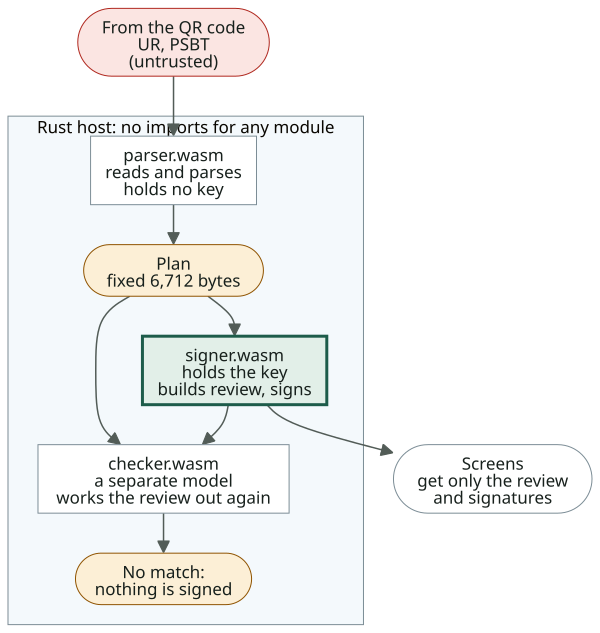

# Security

[日本語](ja/security.md)

To make the project easier to trust, this page describes what is protected where: [how the web app limits what it trusts the browser with](#browser), and [how the signing engine is split up](#engine).

## Trusting the browser engine {#browser}

In the web app the key and the signing engine live in the browser (WebKit on iPhone). The browser itself has to be trusted, so on top of it the app narrows the ways out and the time a key stays in memory.

| Measure | What it does | Stops | Still possible |
| --- | --- | --- | --- |
| Talk only to its own site | Content-Security-Policy with `default-src 'self'`, `connect-src 'self'`, `form-action 'none'`, `object-src 'none'` | Sending to other sites, loading outside scripts | Sending to the same site. Does nothing for a build served by a taken-over site |
| Wipe the key when online | No key loads while online, and a loaded key is wiped the moment the phone goes online | Sending while a key is loaded | It knows only what the browser tells it |
| Wipe the key on leaving | When the page is hidden it wipes the key and covers the screen, and reloads on return | A key left behind while you use other apps | Whether the app switcher keeps a snapshot is up to the browser |
| Zero bytes once used | Entropy, dice rolls, signatures, camera frames | Key material left in memory | JavaScript strings (typed words, the passphrase) cannot be wiped, so the reload discards them |
| Recovery words on the app's own keys | The same keypad as the native apps | Keyboard apps logging them | The passphrase goes through the keyboard; use the built-in one |
| The same signing engine as the native apps | The same WASM modules, run by the same Rust host compiled to WASM ([the engine](#engine)) | Web-only differences in behaviour | The native apps' SHA-256 check does nothing here, as the checking code comes from the site too |
| Run only the build that was added | A service worker takes in every file, so that build runs offline. A new build takes over only when the app is opened again | The build changing behind your back | Going online lets a new build arrive |
| Show the build name | Settings › This build. Built by GitHub Actions, the same commit gives the same name | Missing a replaced build | You trust what you compare it with (the release notes) |
| Encrypt saved keys with a passkey | WebAuthn PRF. Each open asks for Face ID, a fingerprint or the passcode. iPhone needs iOS 18 or later | Reading the browser's data does not open the key | Anyone with the passcode can open it. Needs an Apple Account |

What it cannot stop:

- **Flaws in or tampering with the browser itself**: only OS updates fix those. Keeping the phone offline leaves fewer chances to exploit them.
- **Installing while the site is taken over**: you trust the site at the moment you add the app. To avoid that, [add it from your own Pages](recipes.md#ios-fork).
- **Screenshots and screen recording**: unlike the native apps, it cannot block them.

## How the signing engine is split up {#engine}

The signing engine is three WASM modules, each limited to as little input and output as it needs. All three run as the same bytes in the wasmi host of the native apps (Android, iOS) and of the web app.

### The modules {#modules}

| Module | Role | Built from | What it does |
| --- | --- | --- | --- |
| parser.wasm | Reads untrusted input. Holds no key | C (a Rust version gives the same output), no imports | Joins animated QR codes (UR), parses PSBT v0 and packs it into a fixed 6,712-byte plan. Puts signatures back into the PSBT and encodes it as UR |
| signer.wasm | Holds the key | C (libsecp256k1), no imports | Checks the plan again, builds what the screen shows, and signs. Also mnemonics, SeedQR, BIP32, BIP85, BIP137, xpubs and multisig. Never reads the PSBT itself |
| checker.wasm | A second review. Holds no key | A Lean 4 model compiled to C, then WASM, no imports | A model of what a signer decides before signing, written separately from signer.wasm. Works out the totals, fee, inputs to sign, owner of each output and what the screen shows, and nothing is signed if it differs from signer.wasm by a single byte |

parser.wasm and signer.wasm are built in [bitwasm-signer](https://github.com/habakan/bitwasm-signer), and checker.wasm in bitwasm-signer-lean. checker.wasm's model is btcsigner-spec, with proofs of what it guarantees.

### What each module can read and give out {#access}

The Rust host carries everything between them and gives the modules no imports at all. So no module can touch anything not in the table below, nor the network, files or the clock. The host reads each output from a fixed-size area and zeroes it afterwards.

| | parser.wasm | signer.wasm | checker.wasm | Word entry signer.wasm | Screens |
| --- | --- | --- | --- | --- | --- |
| Seed and private keys | — | Holds*1 | — | — | — |
| Raw QR data | Reads | — | — | — | Gives*2 |
| Plan | Gives | Reads | Reads | — | — |
| Previous transactions | Gives | Reads | Reads | — | — |
| Nonces | Gives | Reads | — | — | — |
| Review and screen text | — | Gives | Reads, gives*3 | — | Reads |
| Signatures | — | Gives | — | — | Reads |
| xpubs, descriptors | — | Gives | — | — | Reads |
| Words, SeedQR | — | Gives*4 | — | Reads*5 | Reads*4 |
| Randomness | — | Reads*6 | — | — | — |

- *1 Given when a key is made or loaded, and never given out.
- *2 Read by the camera and passed to the host.
- *3 Reads signer.wasm's facts and gives its own result.
- *4 Only when made, or when you choose to show them.
- *5 The words being typed. It gives back only suggestions and the checksum result.
- *6 From the host, when making a new key.

- The word entry signer.wasm is a second copy of signer.wasm with no key in it, so typing words never touches the instance that holds the key.
- Signing uses nonces from the coordinator (anti-exfil), so the key cannot be smuggled out in a signature's randomness.
- Wiping the key zeroes signer.wasm's whole memory in the host.
- The keypad's state still lives in the screens' JavaScript. Moving it into the engine is planned.
